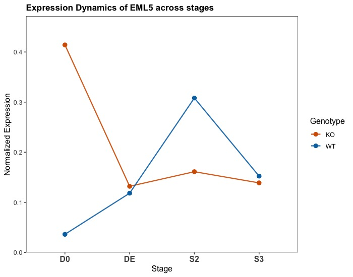

# Targeted-Stencilling

This repo contains the scripts used for analysing the results from targeted chromatin stencilling done on the ZNF808 KO cell line.

## Background

ZNF808 is a primate specific transcription factor that functions by binding to and repressing a specific class of transposable elements called the MER11 elements. Loss of ZNF808 causes pancreatic agenesis, a rare developmental disorder in which the pancreas fails to develop.

When ZNF808 is lost, the MER11 elements which have the potential to act as an enhancer, are no longer repressed, and therefore gains accessibility, causing aberrant gene activation. In vitro stem cell studies have shown higher expression of liver specific genes in the ZNF808 KO cell lines during pancreatic differentiation. Thus ZNF808 may play an important role as a lineage-specifying factor.

## Stencilling/Fiber-seq

[Fiber-seq](https://www.science.org/doi/10.1126/science.aaz1646) also known as stencilling, is a long-read sequencing based assay that simultaneously profiles chromatin accessibility, DNA methylation, nucleosome positioning and transcription factor footprints at a single molecule resolution.

## Targeted Stencilling: Stencilling + ONT's Adaptive Sampling

To understand how the chromatin accessibility and DNA methylation at the MER11s change in the absence of ZNF808, we performed targeted stencilling. This was done using [Oxford Nanopore's (ONT) Adaptive Sampling (AS)](https://nanoporetech.com/document/adaptive-sampling) technology that selectively enriches for reads mapping to the MER11 elements.

Through this targeted approach we get a \>100x read depth (combining WGS and AS) at the MER11s that allow us to study the epigenetic states at a single molecule resolution. The increased coverage also allows the reads to be phased enabling us to resolve haplotype-specific patterns of regulation.

## Analysis:

All the pre-processing of the files were done using [FIBERTOOLS](https://fiberseq.github.io/fibertools/fibertools.html) and the [EPI2ME pipeline](https://epi2me.nanoporetech.com/epi2me-docs/workflows/wf-human-variation/) by ONT. For further processing, including finding the differentially accessible and methylated regions [SMGStats](https://github.com/exetergrdd/SMGStats.jl/tree/main), an in-house developed package was used. For plotting the reads with the linker, nucleosome and FIRE labelling, [SMGDataPlotting](https://github.com/exetergrdd/SMGDataPlotting.jl) package was used.

-   `data`: This folder has all the data required to perform the downstream analysis.

-   `functions`: This folder has all the functions used for running the script

-   `scripts`: This folder contains a markdown script along with the outputs and the plots

## Results:

Over 60% of the MER11s showing gain of accessibility show a significant loss of 5mC methylation (183 out of 288). Interestingly 136 of these MER11s have been previously shown to also lose repressive H3K9me3 and gain activating H3K27ac in the ZNF808 KO.\
\
Targeted stencilling also allows identifying regions showing haplotype specific patterns of epigenetic states. For example MER11 at the locus: `chr14:88765869-88766924`

1.  This MER11 is \~120kb away from the gene *EML5* that is upreglated in the KO.

    

2.  It also shows a significant gain of accessibility and a loss of 5mC methylation. However this loss of methylation is haplotype specific. Both the alleles in the WT are methylated whereas only one of the allele loses methylation at these sites in the KO

    

3.  Additionally we found 2 haplotype specific variants:\
    `chr14:88766509 T>Cchr14:88766553 G>T`

    We tested if the presence of these variants had an impact on transcription factor binding using the [MotifScanner](https://github.com/exetergrdd/MotifScanner.jl) package. The presence of the `C` variant found on the allele retaining methylation in the KO, showed an increased binding potential for transcription factors such as E2F6 and TFDP, which are known repressors that initiate DNA methylation.

    

    
